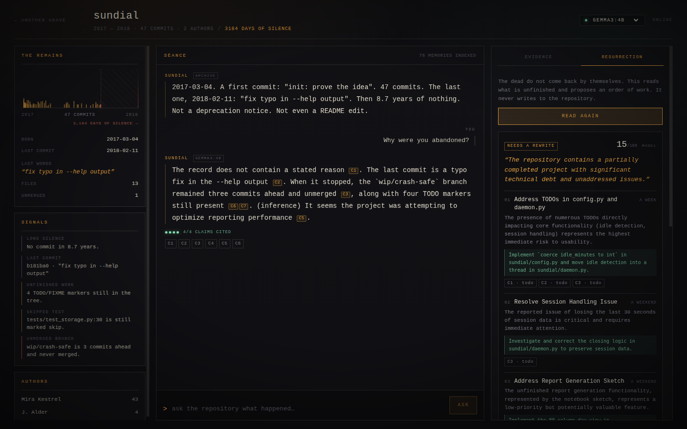
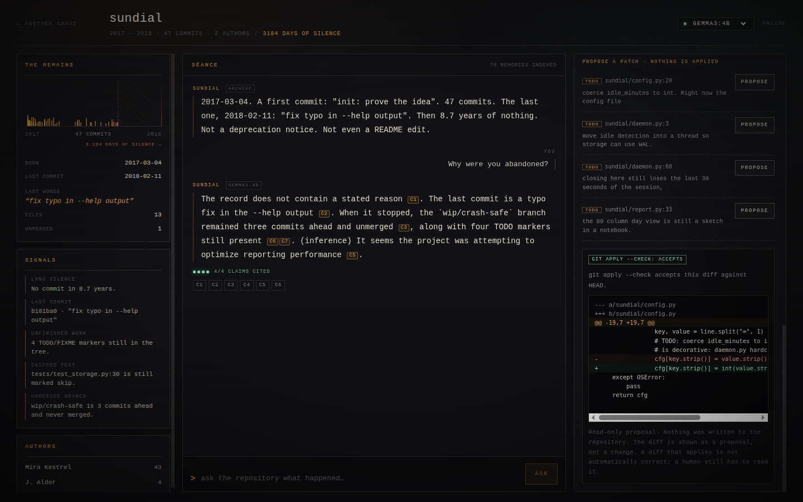

# The Last Commit

**An offline digital archaeologist for abandoned repositories.**

Point it at a git repository that stopped. It reads the history locally, turns
commits, TODOs, skipped tests and unmerged branches into an evidence archive,
and lets you ask the project what happened. The answer is streamed from a small
local model, and every factual sentence carries a citation back to a commit, a
file or a TODO you can open and read for yourself.

No API keys. No cloud. No embedding model. After the import, the Wi-Fi can stay
off.


---

## The 60-second demo

```bash
# 1. a local model (one-time download)
ollama pull gemma3:4b
ollama serve

# 2. the app
./run.sh
# → http://127.0.0.1:8000
```

On the landing page, choose **SUMMON THE SPECIMEN**. It is a real git repository
bundled with the project: *sundial*, 47 commits by two authors between March
2017 and February 2018, then 3,184 days of silence. It has four TODOs still in
the tree, one skipped test, and an unmerged branch called `wip/crash-safe`
that is three commits ahead of the last commit.

Ask it:

> Why were you abandoned?

It will not invent a reason. It answers from the shape of the stop:

> The record does not contain a stated reason [C1]. The last commit is a typo fix
> in the --help output [C2]. When it stopped, the `wip/crash-safe` branch was
> three commits ahead and unmerged [C3], alongside four TODO markers still
> present [C6, C7]. *(inference)* It seems likely that the project stalled due to
> unresolved technical challenges.

`[C3]` is a button. It opens the exact branch record the sentence came from.



Then open **RESURRECTION** and click **BEGIN THE EXCAVATION**. The same evidence
produces an ordered, unromantic revival plan: what blocks the most, what the
first edit is, what to keep, and what could go wrong. Pick any TODO and press
**PROPOSE**. The model writes a minimal edit; the app turns it into a unified
diff; `git apply --check` decides whether it is even applicable. The result is
displayed and thrown away. Nothing is written to the repository.



---

## What makes it different from a repository chatbot

**1. Retrieval is lexical, not vibes.** The archive is built with SQLite FTS5
(BM25). There is no embedding model to download and no vector database to keep
in sync. Questions are matched against an FTS query plus intent-specific
anchors: "why did it stop" pulls the last commit, the unmerged branch and the
oldest TODO; "what is unfinished" pulls TODOs, the skipped test and the branch.
A small cap per kind keeps the context honest instead of stuffing ten near
duplicates into the prompt.

**2. Every memory is addressable.** Each chunk has a stable id
(`commit:b181ba06be`, `todo:sundial/config.py:20`, `branch:wip/crash-safe`).
The model only sees numbered evidence `[C1]…[C7]`, and the UI turns those tags
into buttons that open the underlying record. The citation ledger on the right
is the model's working set, not a decoration.

**3. Grounding is measured, and the measurement is honest.** After each answer
the backend splits it into sentences, counts sentences of five words or more
that carry a `[C#]` tag, and reports coverage plus any citation id that was
never in the evidence. The UI shows `2/3 claims cited · PARTIAL` and an
`unknown citation` flag when the model invents an id.

This is a heuristic, not a proof. It cannot tell whether a cited sentence
actually *follows* from the cited commit. It catches the common failure — a
confident paragraph that cites nothing — and it refuses to hide it. The README
says so, the code says so, and the meter says `PARTIAL` instead of rounding up.

**4. It is allowed to say "the record does not say".** For why-questions the
prompt is explicit: state once that the archive contains no statement of
motive, then describe what was in flight when the work stopped, and mark any
guess `(inference)`. This is the whole point of the project. A ghost that
confabulates a reason is just a chatbot wearing a sheet.

**5. Patches are proposals, never actions.** The model returns a small
find/replace edit. The app locates the exact lines in the file at `HEAD`,
re-indents the replacement to the block it matched, and builds a unified diff
with Python's `difflib`. Then `git apply --check` validates it. If the model
quotes lines that do not exist, the proposal is rejected before a diff is even
shown. The repository is never written to; there is no `git apply`, no commit,
no checkout, and no code execution anywhere in the patch path.

---

## How it works

```
git repository
     │
     ▼
 gitarch.py ── log, diffs, TODOs, skipped tests, branches, tags, gaps
     │
     ▼
 chunks.py ── profile · commit · todo · test · branch · doc · file
     │
     ▼
 SQLite + FTS5 ── one row per memory, BM25 search, no embeddings
     │
     ▼
 retrieval.py ── FTS query + intent anchors + per-kind caps
     │
     ▼
 ghost.py ── prompt (stable prefix first), local Ollama, SSE tokens
     │
     ├── verify() ── sentence coverage, unknown citation ids
     ▼
 React ── streaming answer, inline citation chips, evidence ledger,
          timeline with the silence drawn to scale, resurrection plan,
          read-only patch review
```

Two details that matter on small hardware:

- **The prompt prefix is stable.** System instructions and repository facts are
  in the first message; only the evidence and the question change per turn.
  Ollama can then reuse the prompt cache instead of re-reading the persona on
  every question.
- **The stream is real.** Tokens arrive over Server-Sent Events and render as
  they are produced, so the machine is not a black box for twenty seconds. A
  "thinking" line appears immediately, then the text.

---

## The specimen is synthetic. That is deliberate.

`sundial` is generated by [`samples/make_sample_repo.py`](samples/make_sample_repo.py):
a plausible 2017 command-line time-tracking tool, with a real git history,
two authors, a branch that was never merged, TODOs left in the tree, a skipped
test, and a final commit that fixes a typo in `--help`. The generator is bundled
and the app rebuilds the specimen on first use, so the demo works on a fresh
clone, offline, on any machine.

It is not a real open-source project, and the write-up does not pretend it is.
The point is that the *archaeology* is real: every citation points at an actual
object in an actual git repository that you can inspect with `git log`,
`git show` and `git diff`. The generator exists so that the demo has a known,
reproducible shape — and so that nothing here depends on a stranger's
repository staying online.

The importer accepts any local path or cloneable URL. Real repositories work;
they are simply less predictable, which is why the bundled specimen is the
scripted demo.

---

## Run it

**Requirements**

- Python 3.13 (3.11+ should work; this checkout was built with 3.13)
- Node 18+ only if you want to rebuild the interface
- [Ollama](https://ollama.com) with one small model

```bash
cp .env.example .env      # optional; environment variables are read directly
./run.sh
```

`run.sh` creates `.venv`, installs four Python packages, builds the frontend if
`frontend/dist` is missing, warns if Ollama is down, and serves the app at
`http://127.0.0.1:8000`.

Manual start:

```bash
python3.13 -m venv .venv
.venv/bin/pip install -r requirements.txt
cd frontend && npm install && npm run build && cd ..
OLLAMA_URL=http://127.0.0.1:11434 .venv/bin/uvicorn backend.app:app --port 8000
```

### Models and speed

The default is **`gemma3:4b`** (about 3.4 GB). On a CPU-only laptop expect
roughly 5–8 tokens/second for generation; an answer takes 20–40 seconds. On an
Intel Iris Xe via Ollama's Vulkan backend the same answer takes about 20
seconds. If you have a second Ollama server bound to the iGPU, point the app at
it:

```bash
OLLAMA_URL=http://127.0.0.1:11436 ./run.sh
```

`qwen2.5:3b` is faster and smaller, but it tends to bunch all citations at the
end of a paragraph; `gemma3:4b` follows the "cite each sentence" instruction
more reliably. The model picker in the header lists whatever your Ollama
server actually has — nothing is hardcoded.

No model is required to browse the archive or read the evidence. Without
Ollama, chat falls back to an evidence-only reply that quotes the retrieved
records and says plainly that no model was available.

### Offline

Once the model is pulled, the app makes no outbound request during import,
chat, resurrection or patch review. Importing a URL is the only network path,
and it is explicit. You can verify the claim with the Wi-Fi off: the specimen,
the interface, the database and the model are all local.

---

## API

| Method | Path | What it does |
| --- | --- | --- |
| GET | `/api/health` | app + Ollama status, models, repo count |
| GET | `/api/models` | installed Ollama models |
| GET | `/api/repos` | known graves |
| POST | `/api/repos` | import `{path}` or `{url}`; clones and analyses |
| POST | `/api/specimen` | import the bundled `sundial` repository |
| GET | `/api/repos/{id}` | profile, commits, TODOs, signals, welcome line |
| GET | `/api/repos/{id}/chunk?id=` | one full memory |
| POST | `/api/repos/{id}/chat` | SSE: `meta`, `token`, `notice`, `done` |
| POST | `/api/repos/{id}/revive` | SSE: `stage`, `roadmap` |
| POST | `/api/repos/{id}/patch` | `{chunk_id}` → diff + `git apply --check` verdict |

Chat and revival stream as `text/event-stream`. The patch endpoint is
synchronous and always returns `"applied": false`.

---

## Layout

```
backend/
  app.py        FastAPI routes, SSE, static serving
  gitarch.py    git parsing: log, diffs, TODOs, skipped tests, branches
  chunks.py     memories: profile, commit, todo, test, branch, doc, file
  db.py         SQLite + FTS5 schema and queries
  retrieval.py  BM25 search, intent anchors, evidence caps
  ghost.py      persona, prompt, streaming, citation verification
  revive.py     roadmap JSON, patch construction, git apply --check
  llm.py        thin Ollama client; degrades honestly when it is down
frontend/src/
  App.jsx       landing, grave, timeline, séance, ledger, resurrection
  styles.css    the whole visual system, no external assets
samples/
  make_sample_repo.py   regenerates the sundial specimen
data/repos/sundial/     the specimen (generated on first use, not committed)
```

Reset the archive at any time with `rm data/ghosts.db`; it is rebuilt from the
repositories on the next import.

---

## Limits, stated plainly

- **Grounding is checked structurally, not semantically.** The meter counts
  cited sentences and unknown ids. It does not prove entailment. A small model
  can still cite a real commit for a wrong claim; the evidence is one click
  away precisely so a human can disagree with it.
- **The FTS query is deliberately simple.** Rare words, identifiers and file
  names work well; broad conceptual questions work less well. The intent
  anchors compensate for the common questions, not for every question.
- **Small models are small.** `gemma3:4b` writes serviceable, slightly dry
  prose. It follows the citation format, not literary ambition. The interface
  and the archive carry the atmosphere; the model is not asked to fake depth.
- **The resurrection plan is a proposal, not a maintainer's judgement.** It is
  grounded in TODOs, the skipped test and the unmerged branch, and it can be
  wrong about priority.
- **The specimen is synthetic**, as described above.
- **Very large repositories are truncated** to the first 220 commits by default
  (`GHOST_MAX_COMMITS`). That is a reading window, not the whole history.

---

## Why this exists

Every abandoned repository is a small archive of decisions. The last commit is
usually mundane — a typo fix, a version bump, a README edit — and then nothing.
The reasons are almost never in the record. What *is* in the record is the shape
of the stopping: the branch that was three commits from done, the test that was
skipped "for now" in 2017, the TODO that names the exact thing that was too
hard.

This project does not bring the authors back, and it does not pretend to know
why they left. It makes the shape readable, cites its sources, and offers a
respectful way back in.

Built for the DEV Community challenge, offline on purpose.

MIT licensed.
